# Wazuh SIEM Endpoint Monitoring Lab

Hands-on SOC lab: deploy a Wazuh SIEM, connect a Linux endpoint, generate brute-force, sudo and account-creation activity, then triage each alert and map it to MITRE ATT&CK.

**Author:** Oladosu Felix Abimbola

**Scope:** all activity was run against my own isolated lab machines.

---

## Objective

Practice the analyst workflow end to end: collect endpoint telemetry, generate real alerts, investigate each one, decide what it means, and document it so another analyst can act on it.

## Environment

| Component | Details |
|---|---|
| Virtualization | Oracle VirtualBox on a MacBook Pro (macOS host) |
| SIEM server | Wazuh v4.14.6 OVA, `192.168.56.4` |
| Endpoint | Kali Linux 2026.1 VM (2 CPUs, 2 GB RAM), agent `kali-endpoint`, ID `002`, `192.168.56.5` |
| Attacker | My Mac host on the host-only network, `192.168.56.1` |
| Network | Kali has a NAT adapter for downloads and a host-only adapter (`HostNetwork1`) for lab traffic |

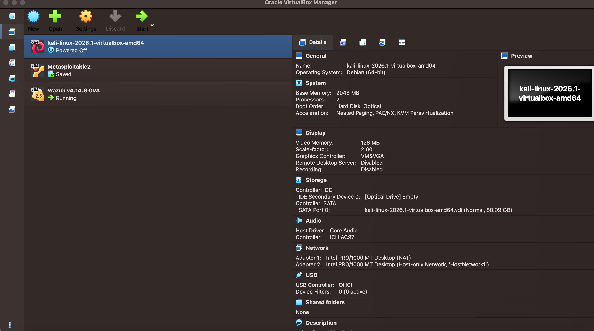
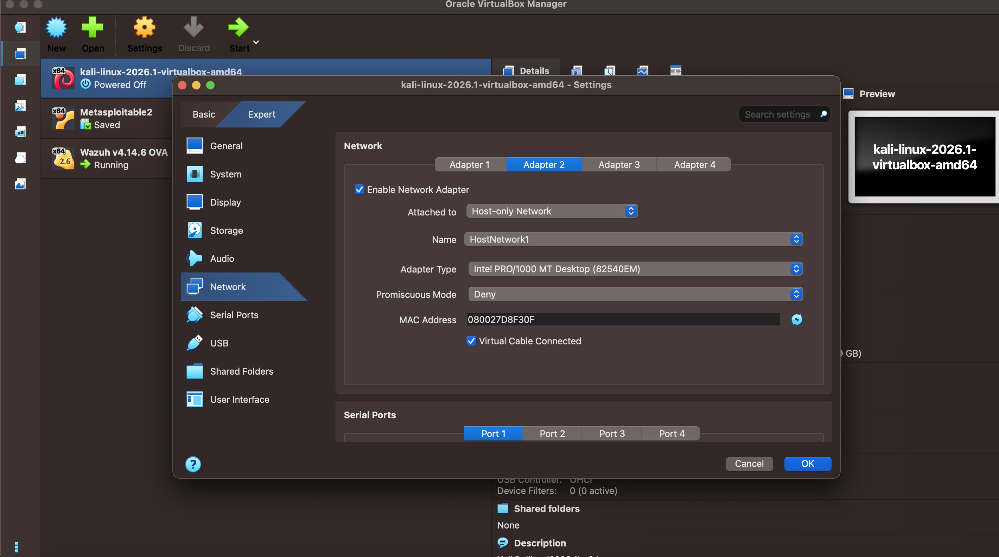

---

## 1. Deployment

1. Imported the Wazuh OVA into VirtualBox and booted it.
2. Gave the Kali VM a host-only adapter alongside its NAT adapter.
3. Confirmed connectivity: Kali's `eth1` is `192.168.56.5/24`, and `ping -c 3 192.168.56.4` returned 3 of 3 replies with 0% loss.
4. Downloaded the 4.14.6 agent and installed it with the manager address and agent name:

```bash
wget https://packages.wazuh.com/4.x/apt/pool/main/w/wazuh-agent/wazuh-agent_4.14.6-1_amd64.deb && sudo WAZUH_MANAGER='192.168.56.4' WAZUH_AGENT_NAME='kali-endpoint' dpkg -i ./wazuh-agent_4.14.6-1_amd64.deb
```

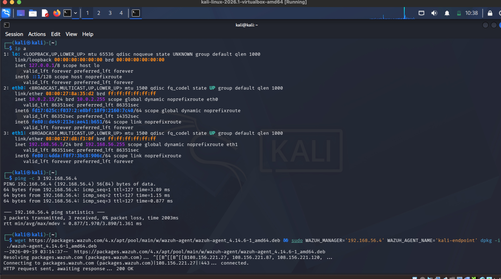

---

## 2. Troubleshooting: agent could not connect

**Symptom:** the agent log (`/var/ossec/logs/ossec.log`) repeated this error:

```
ERROR: (1216): Unable to connect to '[192.168.56.4]:1514/tcp': 'Transport endpoint is not connected'.
```

**Investigation:**
1. From Kali, `nc -zv 192.168.56.4 1515` showed the enrollment port open, so the server was reachable.
2. On the server, `sudo ss -tulnp | grep -E 'remoted|authd'` showed only UDP 514 and TCP 1515. Nothing was listening on TCP 1514.
3. After backing up the config, `grep -B1 -A6 '<remote>' /var/ossec/etc/ossec.conf` showed the secure `<remote>` block (TCP 1514) wrapped inside an XML comment. The only active remote block was syslog on UDP 514.

**Fix:**
1. A first manual edit in nano plus a manager restart did not change the listening ports.
2. I inserted a new secure `<remote>` block with `sed`, then confirmed it with `grep -n '<port>1514'`.
3. I validated the config with `wazuh-analysisd -t` and restarted the manager.
4. `ss` now showed `wazuh-remoted` listening on TCP `0.0.0.0:1514`.
5. After restarting the agent on Kali, it started collecting logs, and the dashboard showed `kali-endpoint` (ID 002, v4.14.6) as **active**.

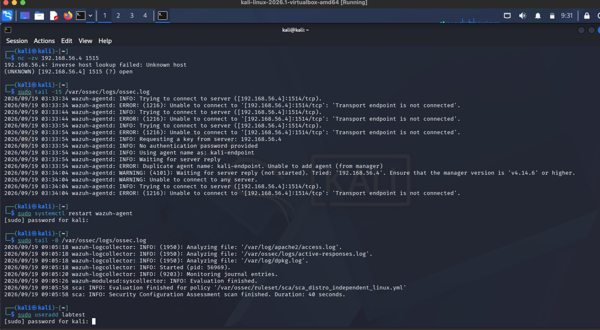

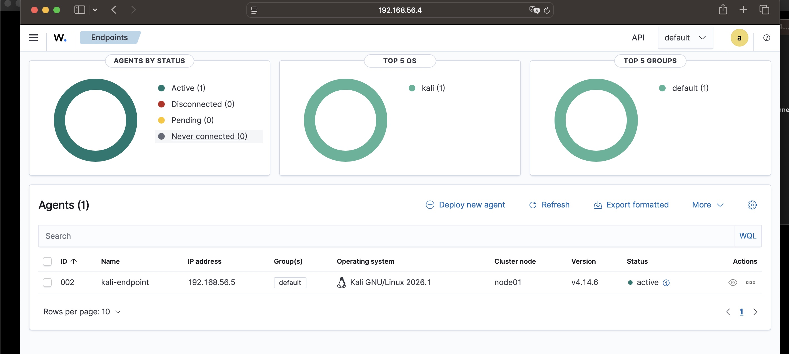

**Takeaway:** a restart does not prove the config took effect. Back up before editing, then confirm the listening ports after every change.

---

## 3. Simulations

| # | Activity | What I did |
|---|---|---|
| 1 | SSH password guessing | From the Mac host, `ssh fakeuser@192.168.56.5` (a user that does not exist) with wrong passwords, repeated across several attempts |
| 2 | Sudo to root | On Kali, `sudo systemctl start ssh` to enable SSH for the test |
| 3 | Account creation | On Kali, `sudo useradd labtest` |

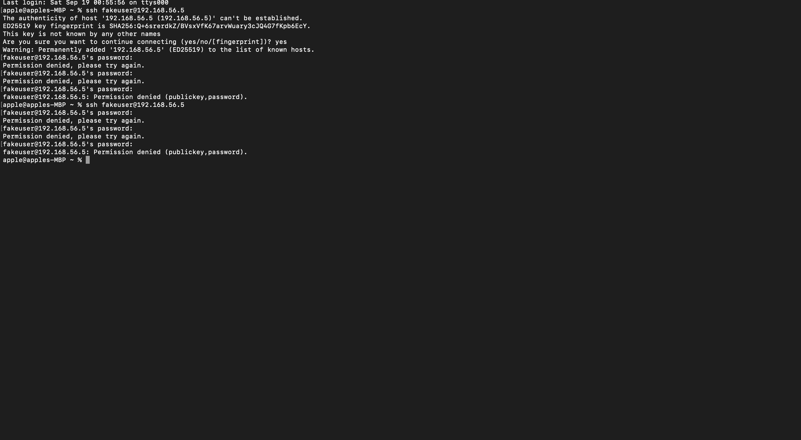

**Note on timestamps:** the dashboard shows my local time (for example 08:40:56), while the raw `full_log` line carries the endpoint's own clock (13:40:35). I use dashboard time in the timeline below.

---

## 4. Alert Triage

The Threat Hunting view showed 236 events in the hour I was testing.

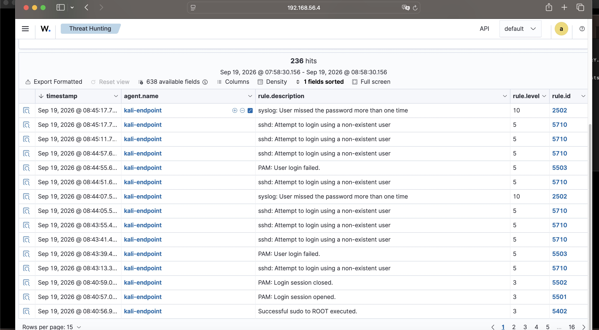

### Alert 1: Rule 2502 (level 10), repeated authentication failures
- **MITRE ATT&CK:** T1110 Brute Force (Credential Access)
- **Agent:** `kali-endpoint` (002), 08:45:17, fired twice (08:44:07 and 08:45:17)
- **Evidence:** PAM logged "2 more authentication failures" for `sshd-session` with `rhost=192.168.56.1`
- **What it means:** the same source kept failing authentication. Wazuh rates this level 10, the highest of the alerts in this lab.
- **Verdict:** True positive, expected. It came from my own SSH attempts.
- **In a real environment:** check whether a successful login (rule 5715) follows from the same source, block or rate-limit it, and review the targeted account.

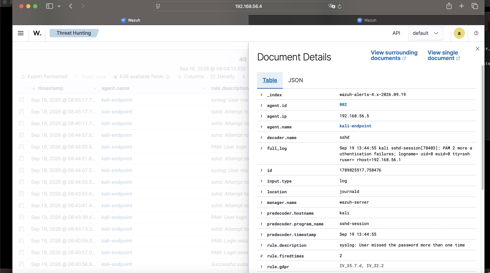
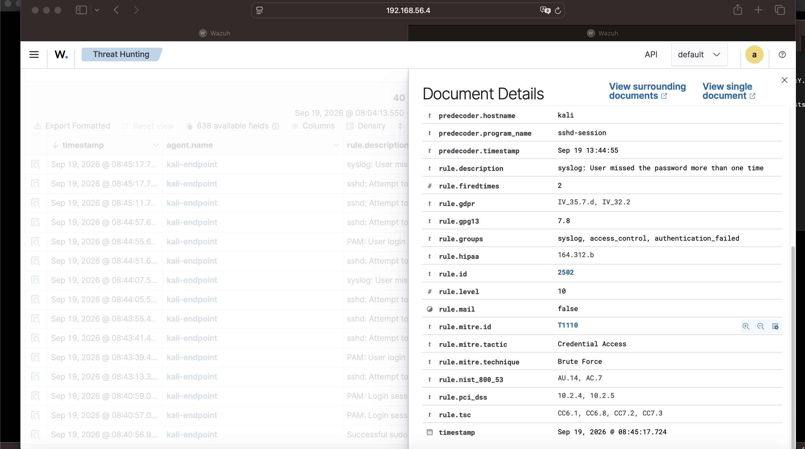

### Alert 2: Rule 5710 (level 5), login attempt for a non-existent user
- **MITRE ATT&CK:** T1110.001 Password Guessing (Credential Access) and T1021.004 SSH (Lateral Movement)
- **Agent:** `kali-endpoint` (002), fired 8 times between 08:43:13 and 08:45:17
- **Evidence:** `Failed password for invalid user fakeuser from 192.168.56.1 port 55845 ssh2`. Source `192.168.56.1`, username `fakeuser`.
- **What it means:** someone tried a username that does not exist. Attackers do this when probing for valid accounts.
- **Verdict:** True positive, expected (my own test).
- **In a real environment:** look for the same source trying other usernames, especially `root` and `admin`, and for any switch to real accounts.

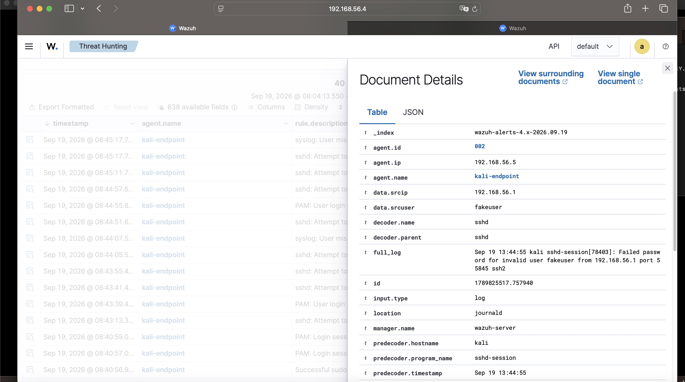
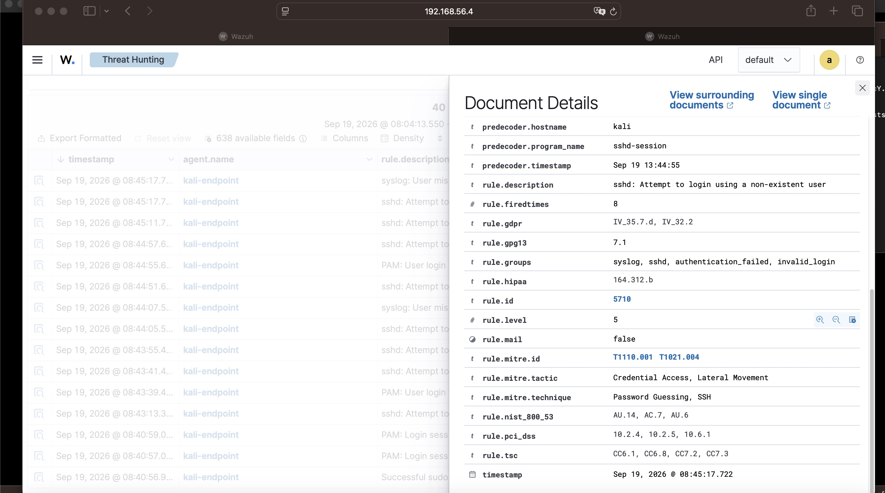

### Alert 3: Rule 5402 (level 3), successful sudo to root
- **MITRE ATT&CK:** T1548.003 Sudo and Sudo Caching (Privilege Escalation, Defense Evasion)
- **Agent:** `kali-endpoint` (002), 08:40:56
- **Evidence:** user `kali` ran `/usr/bin/systemctl start ssh` as `root` from `/home/kali` on `pts/0`. Wazuh flagged it as the first time this user ran sudo, and PAM session open and close events (5501, 5502) followed within seconds.
- **What it means:** an account used sudo to run a command as root. That is often normal admin work, so context decides.
- **Verdict:** Benign. It was my own action to start SSH for the test.
- **In a real environment:** judge it by who ran it, when, and what came before. Sudo starting a network service right after failed logins would be a serious red flag.

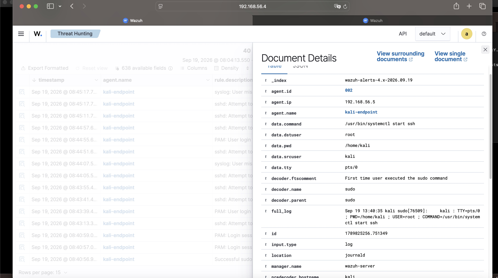
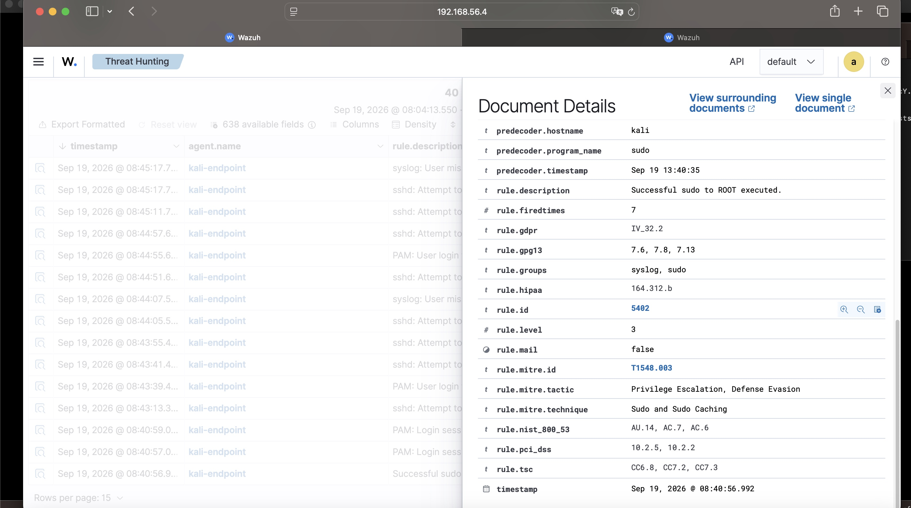

### Alert 4: Rule 5902 (level 8), new user added to the system
- **MITRE ATT&CK:** T1136 Create Account (Persistence)
- **Agent:** `kali-endpoint` (002), 08:32:37
- **Evidence:** `useradd: new user: name=labtest, UID=1001, GID=1001, home=/home/labtest, shell=/bin/sh`. Wazuh also raised "New group added" and a sudo alert at the same second.
- **What it means:** a new local account appeared on the host. Attackers create accounts to keep access.
- **Verdict:** Benign, expected. It was my own test account.
- **In a real environment:** confirm it matches an approved change, check who created it and from where, review its group memberships and any SSH keys, and remove it if unauthorised.

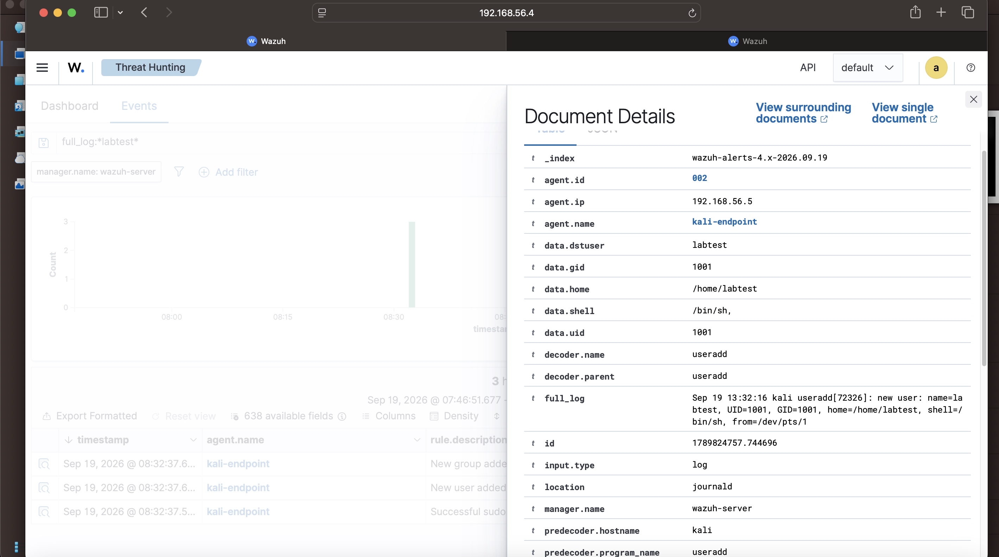
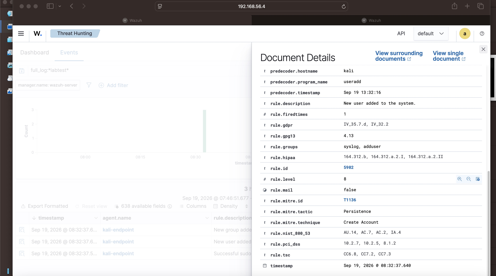

---

## 5. Escalation Note (example)

> **Summary:** Repeated SSH password guessing against `kali-endpoint` (192.168.56.5) from 192.168.56.1, using a username that does not exist (`fakeuser`).
> **Timeline:** 08:43:13 to 08:45:17. 8 invalid-user alerts (rule 5710) and 2 repeated-failure alerts (rule 2502).
> **Impact:** Not determined from these events. Next step is to filter for successful SSH logins (rule 5715) from the same source.
> **Recommended action:** Block or rate-limit the source, disable SSH password login in favour of keys, and keep monitoring for repeat activity.

---

## 6. What I Learned

- Severity is a starting point. The same sudo event can be routine or alarming depending on who, when and what came before it.
- When an agent will not connect, check the manager side first, and verify with `ss` that the service is really listening.
- Notes only count if another analyst can act on them without asking me anything.

## 7. Next Steps

- Add Wazuh active response to block repeated SSH failures automatically.
- Add a Windows endpoint with Sysmon.
- Attacks against an intentionally vulnerable target: see my [Metasploitable2 penetration testing lab](https://github.com/abefeabimbola5811-jpg/Metasploitable2-penetration-testing-lab).

## Tools

Wazuh, Kali Linux, VirtualBox, SSH, sudo, MITRE ATT&CK
